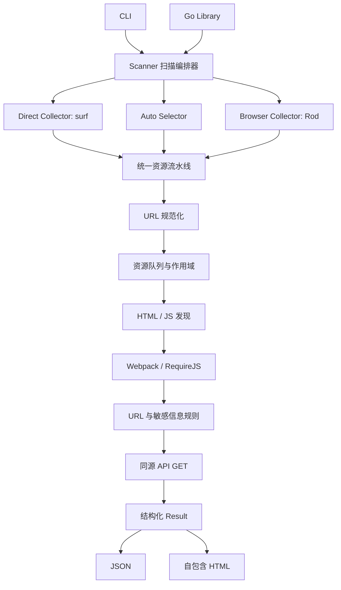

# JsOwl Web 安全信息收集工具设计

## 1. 背景与目标

JsOwl 是一个使用 Go 编写的高性能 Web 安全信息收集工具。它面向合法授权的安全测试环境，从目标站点收集 HTML、JavaScript、动态 chunk 和 API 响应，通过规则提取 URL、API 路径和敏感信息，最后生成 JSON 与自包含 HTML 报告。

项目同时提供 CLI 和可复用 Go 库。CLI 只是公共库 API 的薄封装，其他 Go 项目不需要启动外部进程即可调用完整扫描能力。

首版目标：

- 支持单目标和批量目标。
- 支持 surf 直接请求、Rod 无头浏览器和自动选择模式。
- 深度处理 SPA、Webpack chunk 和 RequireJS。
- 从 HTML、JS、chunk、浏览器流量及 API GET 响应中提取信息。
- 抓取页面引用的跨域 JS/CDN，默认不探测跨域 API。
- 生成结构化 Go 结果、JSON 报告和自包含 HTML 报告。
- 提供明确的并发、深度、大小和时间预算。
- 提供浏览器、配置和规则完整性检查。

首版不执行以下行为：

- 不自动发送 `POST`、`PUT`、`PATCH` 或 `DELETE`。
- 不提交表单，不猜测参数值，不重放可能改变状态的请求。
- 不自动下载 Chrome/Chromium。
- 不实现动态 Go 插件系统。
- 不把完整 API 响应正文写入报告。

## 2. 架构

JsOwl 采用分层流水线架构。surf 和 Rod 是可替换的采集器，二者输出统一数据模型，后续发现、分析、探测和报告流程完全复用。



核心模块：

- `Scanner`：任务入口、生命周期、模式选择、并发和预算管理。
- `Collector`：统一 surf 与 Rod 的采集结果。
- `Discoverer`：从 HTML、JS 和运行时网络记录中发现资源与端点。
- `ChunkResolver`：解析 Webpack、RequireJS 和嵌套动态 chunk。
- `Analyzer`：执行 URL、路径和敏感信息规则。
- `Prober`：对授权范围内的端点执行 GET。
- `Scope`：执行同源判断和额外授权域 allowlist。
- `Reporter`：生成 JSON 和 HTML。
- `BrowserChecker`：检查浏览器路径、版本、启动、CDP 和注入能力。

每个目标独立维护 Cookie、请求头、UA、资源队列、去重集合、预算、扫描结果和错误，禁止批量目标间相互污染。

## 3. 扫描模式

### 3.1 Direct

`direct` 只使用 surf：

1. 请求入口页面。
2. 解析 HTML 和静态脚本。
3. 抓取普通 JS、入口 bundle 和 chunk。
4. 执行规则。
5. 对同源或 allowlist 端点发送 GET。
6. 分析 GET 响应正文。

### 3.2 Browser

`browser` 只使用 Rod 和本机已有的 Chrome/Chromium，采集渲染后 DOM、动态脚本、浏览器网络流量和注入脚本记录。浏览器不可用时返回任务错误，不降级。

### 3.3 Auto

`auto` 是默认模式：

1. 先完成 surf 静态采集。
2. 判断页面是否需要浏览器补充。
3. 需要时启动 Rod。
4. Rod 不可用时保留 surf 结果，记录降级原因，任务仍可成功。

出现以下任一信号时，auto 尝试 Rod：

- HTML 主体内容很少，但存在大型入口 bundle。
- 出现 `webpackChunk`、动态 `import()` 或常见 SPA 根节点。
- 存在 history 路由、hash 路由或脚本动态插入特征。
- 静态阶段未发现端点，但页面明显是前端应用。
- 静态资源与 DOM 信息显示页面内容依赖运行时加载。

## 4. Rod 等待与资源收集

浏览器只使用本机已有 Chrome/Chromium，不在扫描过程中自动下载浏览器。

浏览器页面处理顺序：

1. 创建页面并注册 CDP 网络事件监听。
2. 在站点脚本执行前注入内嵌资源收集器。
3. 导航到目标页面。
4. 等待页面 Load。
5. 等待连续网络空闲。
6. 额外等待异步 JavaScript。
7. 获取渲染后 DOM、Performance 资源、注入脚本快照和 CDP 网络记录。
8. 合并、规范化并去重。

默认等待配置：

| 配置 | 默认值 | 语义 |
|---|---:|---|
| `browser.wait` | `3s` | 页面加载且网络空闲后，继续等待异步 JS |
| `browser.idle` | `800ms` | 判定网络空闲所需的连续静默时间 |
| `browser.timeout` | `45s` | 单页面浏览器采集总上限 |

`browser.wait: 0s` 可以关闭额外等待。

内嵌收集器基于以下参考脚本增强：

`D:\project\exercise\reverse\转子女神\grok\assets\collect_resource_urls.js`

增强版修复原脚本局部集合无法再次读取、动态 script 拦截条件无效等问题，并覆盖：

- DOM 中的 `src`、`href` 和相关资源属性。
- Performance Resource Timing。
- `fetch` 的字符串、URL 和 Request 输入。
- XMLHttpRequest。
- `document.createElement("script")`。
- `setAttribute("src", ...)`。
- `script.src = ...`。
- 动态 DOM 插入与相对 URL。

增强版通过 `window.__jsowlCollector.snapshot()` 返回当前快照。默认使用 `go:embed` 打包，不依赖参考文件的绝对路径。`browser.collector_script` 可指定外部脚本覆盖内嵌版本，`browser.disable_injection` 可完全禁用注入。

## 5. 资源发现与 chunk 处理

### 5.1 发现来源

资源候选来自：

- HTML 的 `script src`、module preload 和资源提示。
- 普通 JS 字符串、fetch、axios、XHR、路由与 URL 赋值。
- Webpack runtime 和 chunk 映射。
- RequireJS 配置和模块声明。
- Rod 渲染后 DOM。
- CDP 网络记录。
- 注入收集器快照。
- API GET 响应正文。

### 5.2 Webpack

Webpack 发现器处理：

- `webpackChunk` 特征。
- `__webpack_require__.p` 或压缩后的等价 public path。
- `__webpack_require__.u` 或等价 chunk filename 模板。
- Webpack 3/4/5 chunk ID、名称和 hash 映射。
- 动态 `import()`。
- 多入口、vendor、commons 和嵌套 chunk。

候选 chunk URL 依次以 public path、当前脚本 URL 和页面 URL 作为解析基准。新 chunk 进入统一队列，下载后重复发现过程。

### 5.3 RequireJS

RequireJS 发现器处理：

- `requirejs.config()` 与 `require.config()`。
- `baseUrl`。
- `paths` 映射。
- `define([...])` 与 `require([...])`。

模块名根据 RequireJS 规则补全路径和 `.js` 扩展名，再进入统一队列。

### 5.4 递归控制

| 配置 | 默认值 |
|---|---:|
| 最大递归深度 | `5` |
| 单目标最大资源数 | `2000` |
| 单响应分析上限 | `10MiB` |
| 单目标资源并发 | `16` |
| 批量目标并发 | `4` |
| 单请求超时 | `15s` |
| 单目标总超时 | `5m` |
| 单 URL 重试 | `1` |

全部限制可通过 YAML 配置调整。CLI 的 `-t/--threads` 只覆盖单目标资源并发。

## 6. 作用域与 API GET

页面引用的跨域 JS/CDN 可以抓取和分析。跨域 API 默认只记录，不发送请求。只有与目标同源或匹配 `scope.allow_domains` 的端点才允许 GET。

API GET 规则：

- 使用目标 Cookie、授权头、随机或用户指定的 UA 和代理。
- 只发送 GET，不先发送 HEAD。
- 跟随重定向，但重定向到未授权域时停止。
- HTML、JavaScript、JSON、XML 和文本响应进入规则引擎。
- 二进制响应只记录元数据。
- GET 响应发现的新 URL 可以入队，但仍受作用域、去重、深度、数量和时间预算限制。
- 不发送请求体，不猜测参数，不提交表单。

## 7. 规则引擎

内置规则参考：

- `D:\project\exercise\reverse\转子女神\source\jsapiscan_regex_31.txt`
- `D:\project\exercise\reverse\转子女神\source\正则表达式总结报告.md`
- JsOwl 的 Webpack、RequireJS、云凭证、JWT、私钥和 URL 补充规则。

公共规则模型：

```go
type Rule struct {
    ID          string
    Name        string
    Category    RuleCategory
    Severity    Severity
    Pattern     string
    Group       int
    Description string
    Enabled     bool
}
```

规则在创建 `Scanner` 时统一编译并只读复用。Go 正则使用 RE2；参考规则中不兼容的表达式转换为等价的 RE2 写法，并使用正向、反向和边界样例验证。无法编译的内置规则视为程序错误。

配置可以禁用内置规则或增加自定义规则。首版不加载动态 Go 插件。

相同发现按“规则 ID + 来源 URL + 完整匹配值”去重。每项发现记录：

- 规则 ID、名称、类别和严重级别。
- 完整匹配值。
- 来源 URL 和资源类型。
- 行号、列号和上下文摘要。

HTML 与 JSON 均保留完整敏感值，不默认脱敏。HTML 必须展示敏感数据安全警告。

## 8. 公共 Go API

单目标调用：

```go
scanner, err := jsowl.New(jsowl.Config{
    Mode: jsowl.ModeAuto,
})
if err != nil {
    return err
}

result, err := scanner.Scan(ctx, jsowl.Target{
    URL: "https://example.com",
})
```

批量调用使用流式结果：

```go
for item := range scanner.ScanBatch(ctx, targets) {
    // item.Target、item.Result、item.Err
}
```

公共结果模型包含：

```text
Result
├── Target、StartedAt、FinishedAt、Mode
├── UserAgent
├── BrowserStatus 与降级原因
├── Resources[]
├── Endpoints[]
├── Findings[]
├── Technologies[]
├── Statistics
└── Issues[]
```

结果按稳定规则排序，以支持测试、报告比较和其他项目消费。

## 9. CLI

CLI 不使用子命令：

```bash
jsowl -u https://example.com
jsowl -u https://a.example -u https://b.example
jsowl -l targets.txt
jsowl -u https://example.com -c config.yml -o reports
jsowl -u https://example.com -m direct
jsowl -u https://example.com -t 32
jsowl -u https://example.com -H "Authorization: Bearer token"
jsowl --check -c config.yml
jsowl -v
```

参数：

| 简写 | 完整参数 | 说明 |
|---|---|---|
| `-u` | `--url` | 目标 URL，可重复 |
| `-l` | `--list` | 目标 URL 文件 |
| `-c` | `--config` | YAML 配置文件 |
| `-o` | `--output` | 覆盖报告输出目录 |
| `-m` | `--mode` | 覆盖扫描模式 |
| `-H` | `--header` | 自定义请求头，可重复 |
| `-t` | `--threads` | 覆盖单目标资源并发 |
| `-v` | `--version` | 显示版本 |
|  | `--check` | 检查配置、规则和浏览器 |
| `-h` | `--help` | 显示帮助 |

`-H` 使用 `Name: value` 格式。CLI 请求头与 YAML 请求头合并，同名字段以 CLI 为准。格式错误在扫描开始前报告。

配置优先级：

```text
CLI 显式参数 > YAML 配置 > 内置默认值
```

未指定 `-c` 时，如果当前目录存在 `config.yml` 则自动加载，否则使用内置默认配置。显式配置文件不存在或无效时直接报错。

## 10. YAML 配置

```yaml
mode: auto

request:
  timeout: 15s
  target_timeout: 5m
  retry: 1
  proxy: ""
  user_agent: ""
  headers: {}
  cookies: {}

browser:
  path: ""
  wait: 3s
  idle: 800ms
  timeout: 45s
  headless: true
  collector_script: ""
  disable_injection: false

concurrency:
  targets: 4
  resources_per_target: 16

limits:
  max_depth: 5
  max_resources: 2000
  max_body_size: 10MiB

scope:
  allow_domains: []
  fetch_external_scripts: true
  probe_external_endpoints: false

output:
  directory: ./jsowl-report
  json: true
  html: true
  download_js: false
  js_directory: js

rules:
  disabled: []
  custom: []
```

浏览器等待、路径、注入、超时等高级参数仅通过 YAML 配置，不增加对应 CLI 参数。

## 11. User-Agent

当 `request.user_agent` 和 `request.headers.User-Agent` 都为空时，JsOwl 从内置的现代桌面 Chrome、Edge 和 Firefox UA 池随机选择。

- 每个目标开始时选择一次。
- 同一目标的 surf、Rod、JS、chunk 和 API GET 使用相同 UA。
- 批量目标可以使用不同 UA。
- 用户指定 UA 后不再随机。
- 最终 UA 写入结果和报告。
- Rod 同步覆盖浏览器 UA，避免静态与动态采集阶段不一致。

## 12. JS 文件下载

`output.download_js` 默认 `false`。启用后保存普通 JS、入口 bundle 和 chunk：

```text
jsowl-report/
└── example.com/
    ├── report.json
    ├── report.html
    └── js/
        ├── app.a81c2.js
        └── chunks/
            └── users.721ef.js
```

文件名需要清理非法字符，正确处理 query、hash 和重名。资源记录保存本地相对路径。超过 `max_body_size` 的文件不保存并记录 Issue。API 响应不受此选项影响，不落盘。

## 13. `--check`

`jsowl --check`：

1. 解析和校验 YAML。
2. 校验时间、容量、并发和作用域字段。
3. 编译内置及自定义正则。
4. 检查输出目录。
5. 搜索或使用配置指定的 Chrome/Chromium。
6. 获取浏览器版本。
7. 使用临时用户目录启动无头浏览器。
8. 建立 CDP 连接并打开本地空白页面。
9. 注入资源收集器并验证快照。
10. 关闭浏览器并清理临时目录。

`--check` 首版只输出适合终端阅读的检查结果，并通过进程退出码表示整体成功或失败。检查代理格式，但不主动访问外部站点。

## 14. 报告

JSON 完整序列化 `Result`。

自包含 HTML 提供：

- 扫描概况、使用模式和浏览器降级状态。
- JS、chunk、API 和外部资源统计。
- 按类别、严重级别和来源筛选。
- API GET 状态码、内容类型和大小。
- 敏感信息完整值、上下文和来源位置。
- 错误、跳过和未扫描原因。
- 敏感数据安全警告。

报告不嵌入完整响应正文，只保存匹配上下文和必要证据。

## 15. 错误处理

错误分为：

- **任务错误**：目标无效、入口完全无法访问、强制 browser 模式无法启动浏览器。`Scan` 返回非空错误。
- **资源错误**：单个 JS、chunk 或 API GET 失败。记录到 `Issues`，扫描继续。
- **降级事件**：auto 无法使用 Rod。保留 surf 结果并记录原因，不视为任务失败。

错误记录包含稳定错误码、目标 URL、阶段、底层错误和是否可重试。

## 16. 项目结构

```text
JsOwl/
├── cmd/jsowl/
├── scanner.go
├── config.go
├── target.go
├── result.go
├── rules.go
├── internal/
│   ├── collect/
│   │   ├── direct/
│   │   └── browser/
│   │       └── assets/
│   ├── discover/
│   │   ├── html/
│   │   ├── javascript/
│   │   ├── webpack/
│   │   └── requirejs/
│   ├── analyze/
│   ├── probe/
│   ├── scope/
│   ├── scheduler/
│   └── report/
├── testdata/
└── docs/
```

## 17. 依赖

- `github.com/enetx/surf`：直接 HTTP 请求。
- `github.com/go-rod/rod`：Chrome CDP 和 SPA 动态采集。
- `github.com/spf13/cobra`：无子命令 CLI 与参数解析。
- `github.com/PuerkitoBio/goquery`：HTML DOM 解析。
- `github.com/cespare/xxhash/v2`：快速去重。
- `golang.org/x/sync`：并发控制。
- `go.yaml.in/yaml/v3`：YAML 配置与严格字段解析。

标准库承担正则、URL、JSON、HTML 模板、结构化日志和 context 取消。

## 18. 性能

- 全局目标 worker pool 与单目标资源 worker pool 分层限流。
- 响应正文流式读取，到达上限立即停止。
- 正则只编译一次。
- URL 在入队前规范化和去重。
- 使用有界队列形成背压。
- JS、chunk 和 API GET 共用单目标资源并发预算。
- Rod 仅在 browser 或 auto 判定需要时启动。
- 批量扫描完成一个目标就返回一个结果。
- 不长期保留不需要落盘的完整响应正文。
- `context.Context` 贯穿请求、队列、分析和浏览器操作。

## 19. 测试

- 每条规则包含正向、反向和边界测试。
- URL 测试覆盖相对 URL、协议相对 URL、query、fragment、跨域和重定向。
- Chunk 测试覆盖 Webpack 3/4/5、public path、hash map、嵌套 chunk 和 RequireJS。
- 使用 `httptest.Server` 构造 SPA、API、重定向、超时和大响应。
- Rod 集成测试在本机浏览器可用时运行，否则明确跳过。
- 测试资源收集器在加载前注入、延迟等待和快照合并。
- JSON 字段断言和 HTML 快照测试。
- 使用 `go test -race ./...` 验证并发安全。
- 为大 bundle、规则匹配、URL 去重和批量吞吐量建立 benchmark。
- 验证 Chrome 缺失、启动失败和 CDP 失败时的 auto 降级。
- 验证 CLI 与 YAML 的优先级、`-H` 合并和 `-t` 覆盖。
- 验证未指定 UA 时按目标随机且同一目标内保持一致。
- 验证 `output.download_js` 的目录、重名、禁用和大小限制。

## 20. 首版完成标准

- CLI 无子命令，支持 `-u`、`-l`、`-c`、`-o`、`-m`、`-H`、`-t`、`-v` 和 `--check`。
- 公共 Go API 支持单目标和批量流式扫描。
- direct、browser 和 auto 行为符合本设计。
- Rod 默认在网络空闲后额外等待 3 秒，且可通过 YAML 修改。
- 使用增强版内嵌资源收集器并与 CDP 网络记录合并。
- 能处理普通页面、SPA、Webpack chunk 和 RequireJS。
- 同源或 allowlist API 只使用 GET，并分析响应正文。
- 页面引用的跨域 JS 可抓取，未授权跨域 API 不请求。
- 未指定 UA 时每目标随机选择，并在该目标内保持一致。
- 用户可以通过 YAML 决定是否下载 JS。
- 生成 JSON 和自包含 HTML 报告。
- 资源限制、超时、浏览器降级和部分失败均有可诊断结果。
- 单元测试、集成测试、竞态测试和关键 benchmark 通过。
